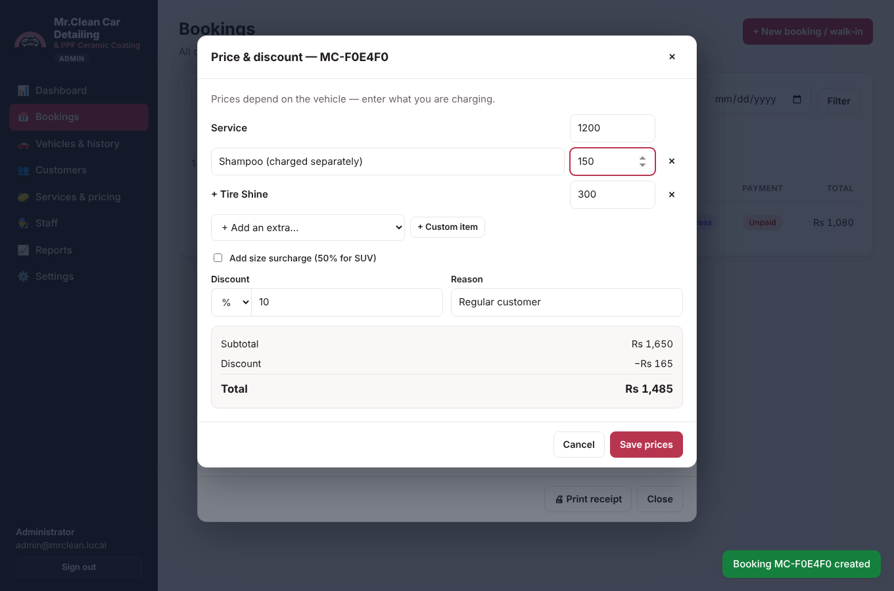
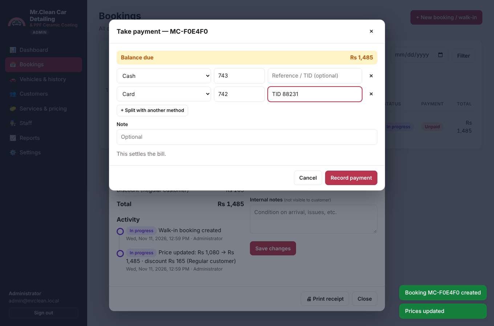
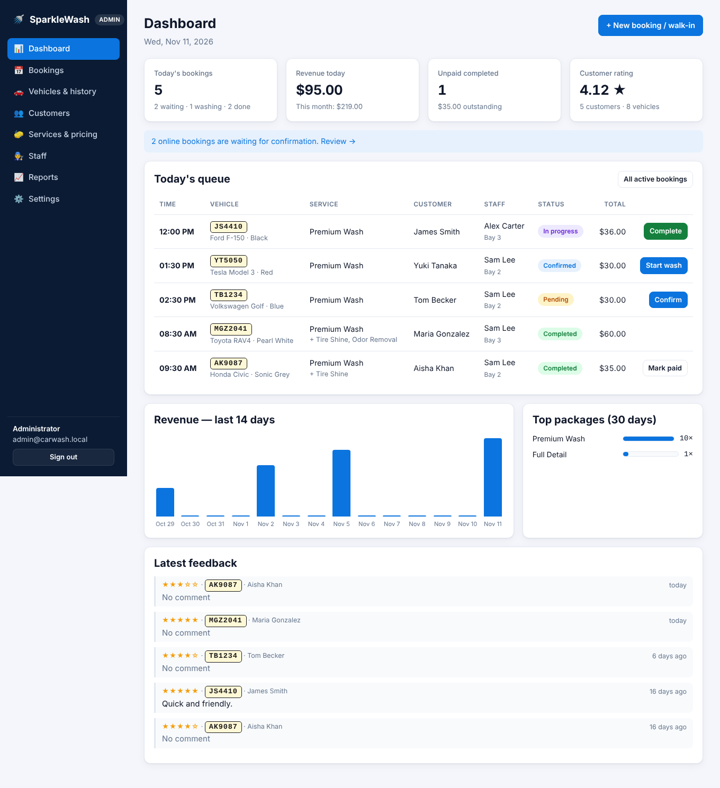
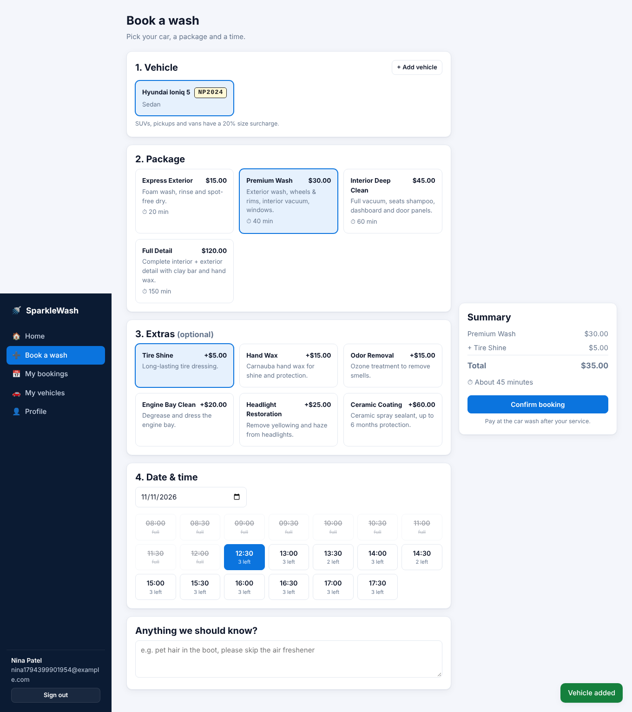
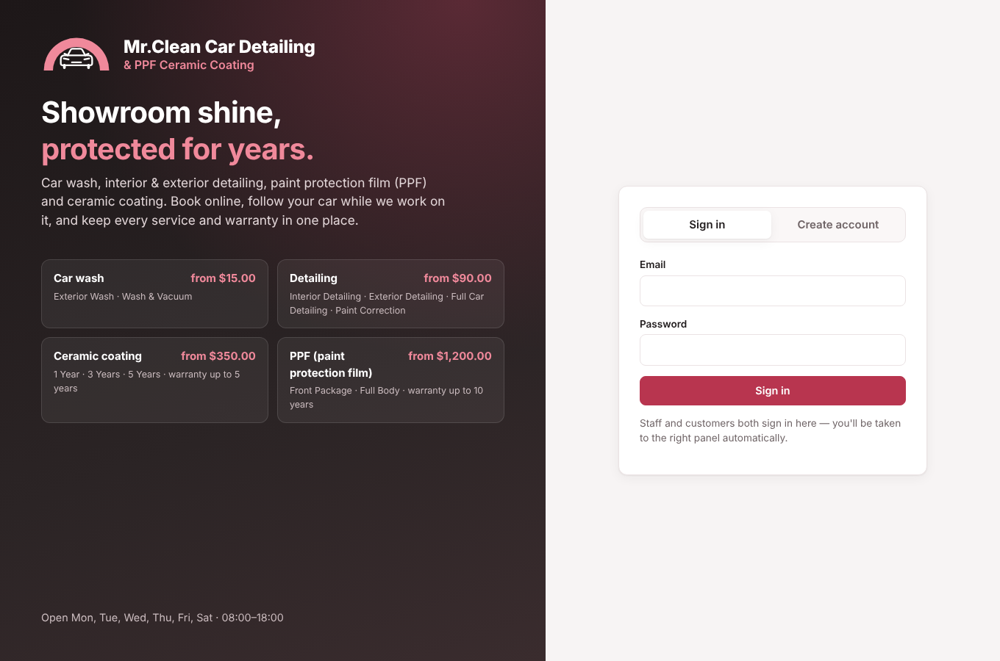
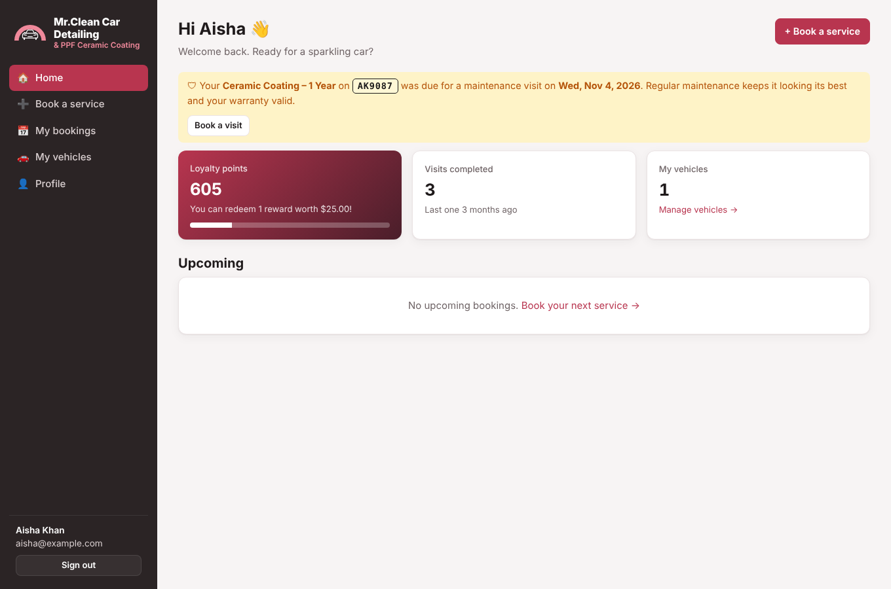

# Mr.Clean Car Detailing & PPF Ceramic Coating — Management App

The booking and management web app for **Mr.Clean Car Detailing & PPF Ceramic Coating**. It has two panels:

- **Admin panel** (`/admin`): runs the shop. It keeps a **full history for every car**, including ceramic coating and PPF warranties.
- **Customer panel** (`/app`): customers register, add their cars, book services, follow the job while it's in the shop, and see their car's history and warranties.

It is built with Node.js, Express and SQLite (the `node:sqlite` module that ships with Node). The frontend is plain HTML, CSS and JS, so there is no build step and only one npm dependency.


## Quick start

Requires **Node.js 22.13 or newer**.

```bash
npm install
npm run seed:demo   # optional: demo customers, cars, ~6 months of history, coatings & PPF
npm start           # http://localhost:3000
```

Sign in at <http://localhost:3000>. The app sends each user to the right panel for their role.

| Role     | Email                 | Password   |
|----------|-----------------------|------------|
| Admin    | `admin@mrclean.local` | `admin123` |
| Customer (demo data) | `maria@example.com` (also james, aisha, tom, yuki @example.com) | `demo123` |

> **Change the admin password** under Settings, or set `ADMIN_EMAIL` and `ADMIN_PASSWORD` before the first start.

> **Prices.** The *Wash* (Rs 500) and *Service* (Rs 700) prices are the standard-car rates from the Star Workers Service Station Union rate list (Rawalpindi/Islamabad). The detailing, ceramic coating and PPF prices are placeholders — set your real prices, work times and warranties under **Services & pricing**, and your phone, address and opening hours under **Settings**. Staff can always change the price of any job at the counter.

## Features

### Built for a detailing, PPF and ceramic coating shop
- **Service lines**: Car wash, Detailing, Ceramic coating and PPF, each with its own packages and add-ons. Every service has a price, a **work time** and an optional **warranty** and **maintenance interval**.
- **Multi-day jobs**: a PPF or coating job keeps its bay until it's done, over several days if needed. Online booking only offers drop-off times when a bay is free for the **whole** job, and every booking shows when the car will be **ready**.
- **Warranties and maintenance**: when a coating or PPF job is completed, the car automatically gets a protection record with the applied date, warranty end date and next maintenance visit. Older work can be added by hand.
- **Follow-ups**: the admin dashboard lists cars whose maintenance visit is due or overdue, and warranties ending within 30 days. Each one shows the owner's phone number and a one-click "Book visit". Customers see the same reminder on their home page.

### Pricing, discounts and payments
- **Manual prices**: prices depend on the vehicle (see the rate list), so staff can set the package price when booking a walk-in, and later change any line on the bill with **Price & discount**. They can also remove extras, add catalog extras, or add **custom items** such as "Shampoo (charged separately)".
- **Size surcharge**: optional for SUVs, pickups and vans (50% by default), switchable per booking.
- **Discounts**: as an amount (Rs) or a percentage, with a reason that appears on the receipt. A percentage discount stays a percentage when prices change. Every price change is logged in the booking's activity with who made it.
- **Split payments**: take payment with **several methods for one bill** (e.g. Rs 500 cash + Rs 1,000 JazzCash), with an optional reference / TID. Partial payments leave a **balance due**.
- **Refunds**: record a refund to any method. If the price is lowered after paying, the bill shows **Refund due**. A payment entered by mistake can be removed (the removal is logged).
- **Payment methods** are set in Settings (default: Cash, Card, JazzCash, Easypaisa, Bank transfer).
- The dashboard shows money **collected today by method**, plus what is still due. Reports show received / refunded / net per method, the amount outstanding, and staff discounts. The CSV export includes paid, balance and methods.

| Price & discount | Split payment |
|---|---|
|  |  |

### Admin panel
- **Dashboard**: today's queue with one-click *Confirm → Start job → Complete* and *Take payment*; revenue; money collected today by method; rating; follow-ups; a 14-day revenue chart; top packages; latest feedback.
- **Bookings**: search and filters. The booking detail covers status changes, staff and bay, rescheduling, mileage, payment, internal notes, an activity timeline and a printable receipt.
- **Walk-ins**: type the plate; a car that has visited before is recognised and its history continues.
- **🚗 Vehicles & history**: every car, with:
  - owner details and stats: visits, total spent, average ticket, last visit, visit frequency, favourite package, rating, mileage
  - **Protection & warranty** cards for coatings and PPF
  - the **complete service history**: package, extras, prices, staff, bay, payment, notes, rating and a status timeline for every visit
  - vehicle notes (damage, preferences, warnings) and a printable history
- **Customers**: profiles, cars, bookings, loyalty points, password reset, and disabling an account.
- **Services & pricing**, **Staff**, **Reports** (with revenue by service line and CSV export) and **Settings** (name, tagline, contact, currency, hours, bays, tax, surcharge, loyalty).

### Customer panel
- Register and add cars. A car that came in earlier as a walk-in keeps its history when the customer adds its plate.
- **Book a service**: services are grouped by line and show their work time and warranty. Customers pick a drop-off time and see when the car will be ready, with a live price (SUV/pickup/van surcharge, tax, loyalty discount).
- **My bookings**: live status, a ready-by time, cancel or reschedule, receipts, ratings, and book again.
- **My vehicles**: the service history plus coating and PPF warranties, with maintenance reminders.
- Loyalty points and profile.

## Screenshots

| Admin dashboard | Customer booking |
|---|---|
|  |  |
| **Sign-in page** | **Customer home (maintenance reminder)** |
|  |  |

## Configuration

Environment variables (all optional):

| Variable          | Default              | Description |
|-------------------|----------------------|-------------|
| `PORT`            | `3000`               | HTTP port |
| `DB_PATH`         | `data/carwash.db`    | SQLite database file |
| `ADMIN_EMAIL`     | `admin@mrclean.local`| Admin account created on first start |
| `ADMIN_PASSWORD`  | `admin123`           | Its password (first start only) |
| `ADMIN_NAME`      | `Administrator`      | Its display name |
| `SECURE_COOKIES`  | `false`              | Set `true` when served over HTTPS |
| `TRUST_PROXY`     | –                    | Express `trust proxy` setting when behind a reverse proxy |

To start from a clean slate, stop the app and delete the `data/` folder. Databases from the earlier version are upgraded automatically on start-up.

## Project structure

```
server.js              entry point
src/
  app.js               Express app, middleware, page guards
  db.js                SQLite schema, seed data, settings
  auth.js              password hashing (scrypt), cookie sessions, role guards
  bookings.js          pricing, bay scheduling (multi-day jobs), status workflow, loyalty,
                       warranties & follow-ups, vehicle history
  routes/public.js     login/register, services, availability
  routes/customer.js   /api/my/*    (customer panel)
  routes/admin.js      /api/admin/* (admin panel)
public/
  index.html           landing + sign in / register
  admin/               admin panel (index.html + admin.js)
  app/                 customer panel (index.html + app.js)
  css/style.css        shared styles in the Mr.Clean colours (light & dark mode, responsive)
  img/                 logo and favicon
  js/common.js         shared UI helpers (API client, modals, router, charts)
scripts/seed-demo.js   demo data
test/api.test.js       API tests (node:test)
```

## Tests

```bash
npm test
```

The tests cover manual prices, discounts, split payments and refunds, multi-day bay scheduling, warranty and maintenance tracking, follow-ups, database upgrades, authentication and role protection, vehicle ownership, pricing and surcharges, slot capacity, the booking lifecycle, loyalty points (earning, redeeming and refunding), walk-in history being claimed by a customer, the vehicle history endpoint, reports and CSV export, and admin CRUD.

## Security notes
- Passwords are hashed with scrypt. Sessions are random tokens stored server-side in an `HttpOnly`, `SameSite=Lax` cookie.
- State-changing API calls must be JSON, which blocks plain cross-site form posts. Login and registration are rate-limited.
- Customers can only see their own cars and bookings. Internal staff notes and vehicle notes are never sent to the customer API.
- CSV export escapes spreadsheet formulas.
