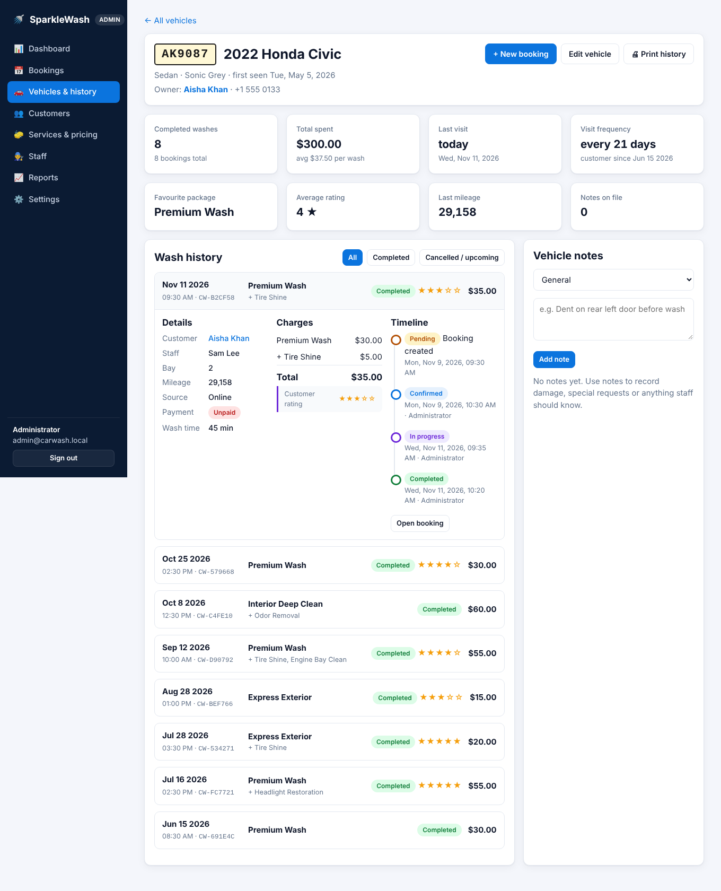

# 🚿 Car Wash Manager

A complete car wash management web app with two panels:

- **Admin panel** (`/admin`): runs the business. It includes a **full history for every car**.
- **Customer panel** (`/app`): customers register, add their cars, book washes, track status and see their own wash history.

It is built with Node.js, Express and SQLite (the `node:sqlite` module that ships with Node). The frontend is plain HTML, CSS and JS, so there is no build step and only one npm dependency.



## Quick start

Requires **Node.js 22.13 or newer**.

```bash
npm install
npm run seed:demo   # optional: demo customers, cars and ~6 months of wash history
npm start           # http://localhost:3000
```

Sign in at <http://localhost:3000>. The app sends each user to the right panel for their role.

| Role     | Email                 | Password   |
|----------|-----------------------|------------|
| Admin    | `admin@carwash.local` | `admin123` |
| Customer (demo data) | `maria@example.com` (also james, aisha, tom, yuki @example.com) | `demo123` |

> **Change the admin password** under Settings, or set `ADMIN_EMAIL` and `ADMIN_PASSWORD` before the first start.

## Features

### Admin panel
- **Dashboard**: today's bookings, washing now and done, today's and this month's revenue, unpaid jobs, average rating, a 14-day revenue chart, top packages and the latest feedback.
- **Live queue**: today's cars with one-click *Confirm → Start wash → Complete* and *Mark paid* buttons.
- **Bookings**: search by plate, code, name or phone. Filter by status, payment and date range. The booking detail lets staff:
  - change status: pending → confirmed → in progress → completed, or cancelled / no-show
  - assign staff and a wash bay, reschedule, and record mileage
  - record payment (cash, card, mobile) and keep internal notes the customer never sees
  - view the full activity timeline (who did what, and when) and print a receipt
- **Walk-ins**: book a car that arrives without an appointment. Type the plate and the car is created, or reused if it has visited before. The booking can start right away.
- **🚗 Vehicles & history**: every car that has visited. Each car's page shows:
  - owner, type, colour and year, and when the car was first seen
  - stats: completed washes, total spent, average ticket, last visit, how often it visits, favourite package, average rating, last mileage, and cancellations and no-shows
  - **the complete wash history**: each visit expands to show the package, extras, price breakdown, staff, bay, mileage, payment, customer and internal notes, rating, and a status timeline
  - **vehicle notes** for damage, preferences and warnings, e.g. "dent on rear door (pre-existing)"
  - a printable history
- **Customers**: list and profile with their cars, bookings, total spent and loyalty points. Admins can adjust points, reset a password, or disable the account.
- **Services & pricing**: create, edit and hide wash packages and add-on extras (price and duration). Services that appear in past bookings are hidden instead of deleted, so history stays correct.
- **Staff**: add and edit staff, see jobs done today and in total, average rating, and who is washing right now.
- **Reports**: any date range (with presets). Shows revenue, washes, average ticket, cancellations, daily revenue, and breakdowns by package, add-on, staff, payment method, busiest hours and vehicle type. **CSV export.**
- **Settings**:
  - business name, address, phone and currency
  - opening hours, open days, slot length, number of bays (cars per slot) and how far ahead customers can book
  - tax rate and the large-vehicle surcharge
  - the loyalty programme rules

### Customer panel
- Register and sign in.
- **My vehicles**: add, edit or remove cars, and view each car's wash history. If a car has visited before as a walk-in, adding its plate links the existing history to the account.
- **Book a wash**:
  - choose a car, a package and extras, then pick a date and a **free time slot** (slots are limited by the number of bays)
  - a live price summary shows the SUV, pickup and van surcharge, tax and loyalty discount
- **My bookings**: live status (pending, confirmed, in progress, completed) with a timeline. Customers can cancel or reschedule, view and print the receipt, **rate a wash 1–5 stars with feedback**, and book again in one click.
- **Loyalty points**: earned on each completed wash and redeemed for discounts. Points come back if the booking is cancelled.
- **Profile**: update details and change the password.

## Screenshots

| Admin dashboard | Customer booking |
|---|---|
|  |  |

## Configuration

Environment variables (all optional):

| Variable          | Default              | Description |
|-------------------|----------------------|-------------|
| `PORT`            | `3000`               | HTTP port |
| `DB_PATH`         | `data/carwash.db`    | SQLite database file |
| `ADMIN_EMAIL`     | `admin@carwash.local`| Admin account created on first start |
| `ADMIN_PASSWORD`  | `admin123`           | Its password (first start only) |
| `ADMIN_NAME`      | `Administrator`      | Its display name |
| `SECURE_COOKIES`  | `false`              | Set `true` when served over HTTPS |
| `TRUST_PROXY`     | –                    | Express `trust proxy` setting when behind a reverse proxy |

To start from a clean slate, stop the app and delete the `data/` folder.

## Project structure

```
server.js              entry point
src/
  app.js               Express app, middleware, page guards
  db.js                SQLite schema, seed data, settings
  auth.js              password hashing (scrypt), cookie sessions, role guards
  bookings.js          pricing, availability, status workflow, loyalty, vehicle history
  routes/public.js     login/register, services, availability
  routes/customer.js   /api/my/*    (customer panel)
  routes/admin.js      /api/admin/* (admin panel)
public/
  index.html           landing + sign in / register
  admin/               admin panel (index.html + admin.js)
  app/                 customer panel (index.html + app.js)
  css/style.css        shared styles (light & dark mode, responsive)
  js/common.js         shared UI helpers (API client, modals, router, charts)
scripts/seed-demo.js   demo data
test/api.test.js       API tests (node:test)
```

## Tests

```bash
npm test
```

The tests cover authentication and role protection, vehicle ownership, pricing and surcharges, slot capacity, the booking lifecycle, loyalty points (earning, redeeming and refunding), walk-in history being claimed by a customer, the vehicle history endpoint, reports and CSV export, and admin CRUD.

## Security notes
- Passwords are hashed with scrypt. Sessions are random tokens stored server-side in an `HttpOnly`, `SameSite=Lax` cookie.
- State-changing API calls must be JSON, which blocks plain cross-site form posts. Login and registration are rate-limited.
- Customers can only see their own cars and bookings. Internal staff notes and vehicle notes are never sent to the customer API.
- CSV export escapes spreadsheet formulas.
